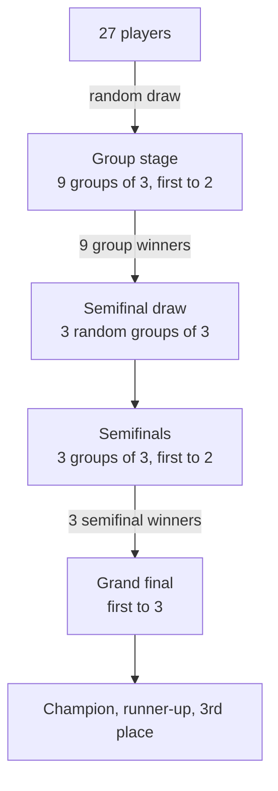

# PvP Tournament Format — 27 Players

How the guild's 1v1v1 PvP tournament runs with **27 players**, exactly as the tracker applies it. 27 is the simplest supported size: every group winner goes through, so there are no host picks, no survival game and no tiebreak draws. Other player counts (21, 24, 30) and the full specification are in [pvp-app.md](pvp-app.md); the host's step-by-step list is [pvp-host-checklist.md](pvp-host-checklist.md).

## At a glance

| Stage       | Who plays                        | Series | Format               | Games per series |
| ----------- | -------------------------------- | ------ | -------------------- | ---------------- |
| Group stage | All 27 players, in 9 groups of 3 | 9      | First to 2 game wins | 2 to 4           |
| Semifinals  | The 9 group winners, in 3 groups | 3      | First to 2 game wins | 2 to 4           |
| Grand final | The 3 semifinal winners          | 1      | First to 3 game wins | 3 to 7           |
| **Total**   |                                  | **13** |                      | **27 to 55, about 40 expected** |

There's one arena, so series are played one at a time, normally in number order: Group 1 to Group 9, then Semifinal 1 to 3, then the final.

---

## 1. Games and series

- **A game** is a 1v1v1 match between the three players of a group. The host records the finishing order: 1st, 2nd and 3rd.
- **A series** is a group of three playing games until one player reaches the target number of game wins: **2** in the group stage and semifinals, **3** in the grand final.
- With three players, the wins can split. In a first-to-2 series, each player can win one game (1-1-1), so a series lasts **2 to 4 games**. In the first-to-3 final, all three can reach 2-2-2, so it lasts **3 to 7 games**.
- **Points** are 3 for 1st, 1 for 2nd and 0 for 3rd in each game. They don't decide who wins a series, only the final's 2nd and 3rd places (§5) and replacement suggestions (§6).

How long a series lasts when all three players are evenly matched:

| Series     | 2 games | 3 games | 4 games | 5 games | 6 games | 7 games | Average |
| ---------- | ------- | ------- | ------- | ------- | ------- | ------- | ------- |
| First to 2 | 33%     | 44%     | 22%     |         |         |         | 2.89    |
| First to 3 |         | 11%     | 22%     | 30%     | 25%     | 12%     | 5.05    |

## 2. The group draw

1. The host enters the 27 participants and presses **Draw groups**. The app shuffles them at random into **9 groups of 3**, numbered in play order.
2. Viewers see the draw straight away. The host can redraw, or swap two players between groups, until the group stage starts.
3. If someone doesn't show up, the host can swap in a **reserve** for them before their group plays. The rest of the draw stays as it is.

## 3. Group stage

- Each of the 9 groups plays one **first-to-2** series.
- **The group winner goes through to the semifinals.** That's 9 winners for 9 semifinal spots, so nobody else qualifies, and no record comparison or tiebreak is ever needed.
- 2nd and 3rd place in a group are out of the tournament. Their group-stage record (game wins, then points per game) only matters if a semifinalist has to be replaced (§6).

## 4. Semifinals

- Once all 9 groups are decided, the host presses **Draw the semifinal groups**. The 9 winners are shuffled at random into **3 groups of 3**. There's no seeding: the groups are pure luck.
- The draw keeps players who met in the group stage apart. With 27 players that never comes up, because each semifinalist won a different group.
- The host can swap players between the drawn groups or redraw. **Viewers don't see the semifinal groups until the host starts the semifinals**, so nobody watches a draft change.
- Each semifinal is a **first-to-2** series. The 3 semifinal winners go to the grand final.

## 5. Grand final and prizes

- The 3 semifinal winners play one **first-to-3** series.
- **All three places win a prize:**
  - **Champion (Vô địch):** the winner of the final.
  - **Runner-up (Á quân) and 3rd place (Hạng ba):** the other two finalists, ranked by the **points they scored in the final** (3 for 1st, 1 for 2nd, 0 for 3rd in each game).
  - **Level on points:** both are runners-up, and there's no 3rd place.
- Example: Lan wins games 1, 2 and 4, so she's champion. Minh finished 3rd, 3rd, 1st, 2nd (0 + 0 + 3 + 1 = 4 points) and Hoa finished 2nd, 2nd, 3rd, 3rd (1 + 1 + 0 + 0 = 2 points), so Minh is runner-up and Hoa is 3rd. Had they finished on the same points, both would be runners-up.

## 6. When something goes wrong

| Situation                                                    | What happens                                                                                                                                       |
| ------------------------------------------------------------ | -------------------------------------------------------------------------------------------------------------------------------------------------- |
| A player doesn't show up before their group plays            | A reserve takes their place in the event; the other groups stay as drawn                                                                           |
| A player is absent, forfeits or disconnects during a series  | The host either keeps recording games with them in 3rd, or ends the series with a **ruling**: the host names the winner and a reason that viewers see |
| A semifinalist has to leave before their semifinal starts    | The host replaces them with a player who didn't qualify. The app suggests the best group-stage record first (most game wins, then most points per game) |
| A finalist has to leave before the final starts              | The host replaces them with one of the other two players from their semifinal, best semifinal record suggested first                              |
| A wrong result is saved                                      | The host undoes the last game, or goes back a stage to fix an earlier one; everything after it is recalculated                                    |

Once a series has its first game, its players can't be replaced; the host uses a ruling instead.

## 7. Discord predictions

Predictions run as EasyPolls on Discord and never affect the bracket. Every one of the 13 series gets **two polls**, so 26 in total:

| Poll                 | Question                                    | Who's right                                                         |
| -------------------- | ------------------------------------------- | ------------------------------------------------------------------- |
| Who wins?            | "Bảng 3: ai sẽ thắng?"                      | Everyone who picked the series winner (a ruling's winner counts)    |
| Over/under games     | "Bảng 3: kèo 2,5 ván, Trên hay Dưới?"       | Over if the series lasted more games than the line, under if fewer  |

- **Lines:** 2.5 games for the group stage and semifinals, 4.5 for the final. They're fixed so the two answers are close to a coin flip (about 48% under in the group stage, 49% in the semifinals and 47% in the final), and a half-line means a series can never land exactly on it.
- A series decided by a **ruling** voids its over/under votes, since its game count says nothing about the players.
- Polls should close before the series' first game.

### The Oracle Ranking (Bảng Thần Toán)

The viewer page ranks every voter as series finish. A correct pick on either question is worth more the later the phase:

| Phase       | Polls | Points per correct pick | Points available |
| ----------- | ----- | ----------------------- | ---------------- |
| Group stage | 18    | 1                       | 18               |
| Semifinals  | 6     | 2                       | 12               |
| Grand final | 2     | 3                       | 6                |
| **Total**   | **26** |                        | **36**           |

So a perfect run is 36 points, and calling the final right on both questions is worth as much as six group-stage polls. Each score reads as points out of the points the member's picks could have won, for example 33/36.

1. Most points, counting both questions.
2. Then fewer possible points, since the same points from fewer or cheaper picks means better accuracy.
3. Then by name.

**Prize places:** members level on both points and possible points share a place. Places go to whole tie groups in order and **stop as soon as three members hold one**, so ties never add extra winners:

| Scores (points/possible)  | Places                                                        |
| ------------------------- | ------------------------------------------------------------- |
| 30/36, 28/36, 27/36       | 1st, 2nd, 3rd                                                 |
| 30/36, 30/36, 28/36, 27/36 | 1st, 1st, 2nd; no 3rd place                                  |
| 30/36, 28/36, 28/36, 28/36 | 1st, 2nd, 2nd, 2nd; no 3rd place                             |
| 30/36, 30/36, 30/36, 30/36 | 1st ×4; no 2nd or 3rd place                                  |
| 30/36, 28/36, 27/36, 27/36 | 1st, 2nd, 3rd, 3rd (a tie for the last place can't be split) |
| 30/36, 30/34              | 30/34 is 1st and 30/36 is 2nd (fewer possible points wins the tie) |

## 8. Timing

- The whole event is **13 series and about 40 games**: about 26 in the group stage, 9 in the semifinals and 5 in the final. At least 27, at most 55.
- The viewer page estimates when the current series will finish from how long recent games took, and shows which series is up next.
